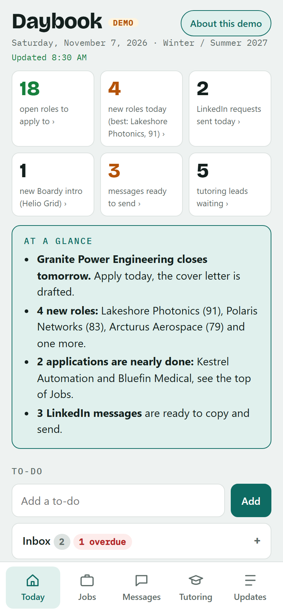
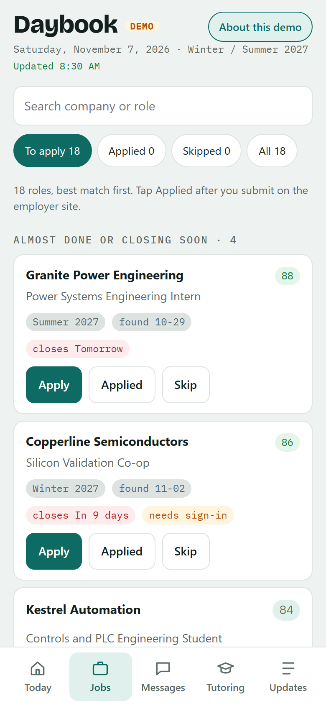
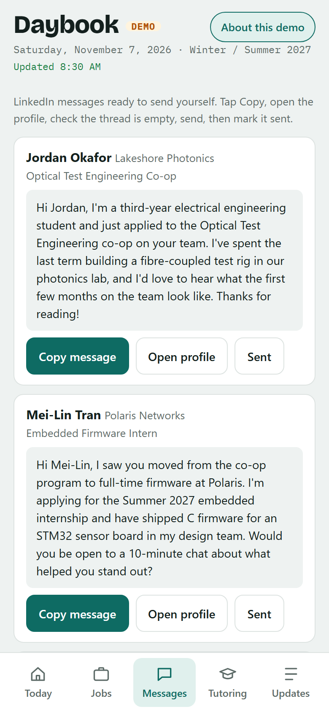
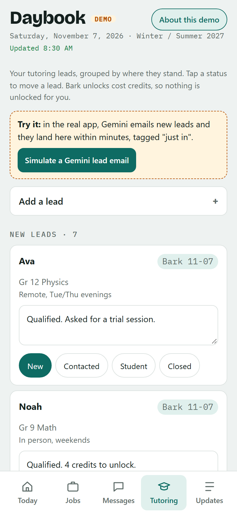
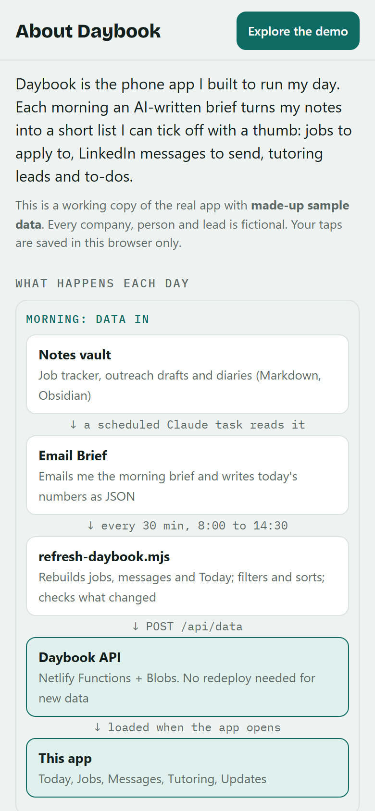

# Daybook

A phone web app that turns an AI-written morning brief into a day planner you can tick off with your thumb: jobs to apply to, LinkedIn messages to send, tutoring leads to follow up and to-dos, all on one screen.

I built it for my own co-op search and tutoring side business. This repo is a **portfolio copy with made-up sample data**. Every company, person, lead and link in it is fictional, and the backend code reads every secret from environment variables.

**Live demo:** https://tallpeasley.github.io/daybook/ (best on a phone, or your browser's phone view). Or open `site/index.html` through any static server (see [Run it locally](#run-it-locally)). An "About this demo" sheet explains everything on first open.

| Today | Jobs | Messages | Tutoring | About |
|---|---|---|---|---|
|  |  |  |  |  |

## What it does

- **Today:** key numbers (each tile jumps to its tab), an "At a glance" summary, to-dos synced with TickTick, "Needs your attention" items with Done ticks, top roles, upcoming dates and overdue items.
- **Jobs:** open roles grouped into *almost done or closing soon*, *new in the last 2 days*, and *everything else by match score*, with lower matches folded away. Search, filter, Apply link, and Applied / Skip buttons.
- **Messages:** LinkedIn messages drafted overnight. Copy, open the profile, send by hand, mark sent. Nothing is ever sent automatically.
- **Tutoring:** leads moved between New, Contacted, Students and Closed, with notes. New leads arrive live from Gemini.
- **Updates:** notes for my AI assistants (sent by email or the share sheet) and each automation's daily report.
- **Home-screen widget:** a Scriptable widget shows roles, to-dos, messages, leads and what's due next.

## How it works

```
 Notes vault (Obsidian, Markdown)
   │  scheduled Claude task, every morning ("Email Brief")
   ▼
 morning email + Tools/brief/daybook-today.json
   │  tools/refresh-daybook.mjs, every 30 min 8:00-14:30 (Windows Task Scheduler)
   ▼
 POST /api/data ──► Daybook API (Netlify Functions + Netlify Blobs) ◄──► phone app
                         ▲            ▲             ▲         │
     Gemini email ──► Apps Script     │        TickTick     taps ──► /api/state
     "Daybook lead"   /api/leads      │        (OAuth)               │
                                 /api/widget                        ▼
                                 Scriptable widget       Handoff/Daybook-Ticks.md
                                                         (read by tomorrow's brief)
```

1. **Daily Email Brief refresh.** A scheduled Claude task reads my vault (job tracker, outreach drafts, diaries), emails me a brief and writes `daybook-today.json` ([format](docs/daily-brief-format.md)). `tools/refresh-daybook.mjs` merges that with the job tracker and pending LinkedIn messages, applies filters (excluded companies, closed roles), and POSTs the result to `/api/data`. The page loads instantly from the copy built into it, then swaps in the newer data. Data changes don't need a redeploy, which matters on a free hosting plan with limited build credits; the script only redeploys when the page or API code changes (it hashes code and data separately).
2. **Vault tap sync.** Every Applied, Skip, Sent and Done tap is saved on the phone and sent to `/api/state` (whole-object, newest timestamp wins, so two phones can't silently clobber each other). The next refresh writes the taps into the vault as `Handoff/Daybook-Ticks.md`, and the next morning's brief treats them as my word and drops finished items.
3. **TickTick sync.** The API does the TickTick OAuth flow (with a one-time `state` value) and keeps the token in Netlify Blobs. The Today tab lists open tasks from every list, adds new ones to the Inbox and completes them when ticked. Without TickTick it falls back to a list on the phone.
4. **Gemini lead intake.** A Gemini scheduled task emails new tutoring leads as a JSON block with subject "Daybook lead" ([format](docs/gemini-lead-format.md)). `tools/gemini-leads.gs` (Google Apps Script) checks Gmail every 5 minutes, POSTs them to `/api/leads` and labels the thread so it's sent once. They show in Tutoring as "just in".
5. **Widget.** `widget/daybook-widget.js` (Scriptable, iOS) reads `/api/widget`, which combines the day's numbers with live TickTick counts.

## In this demo

| | |
|---|---|
| Real | The page: production code, one HTML file, no framework, no build step. The API, refresh script, Apps Script and widget code in this repo. |
| Simulated | TickTick (a pretend account in memory), tap sync (stays in your browser), live leads (a "Simulate a Gemini lead email" button) and the widget (a preview in the About sheet). |
| Removed | My notes, contacts, leads, API key and site addresses. |

`site/config.js` turns on demo mode. The demo also rebases the sample dates to today each time it opens (the "Demo shim" block near the end of `site/index.html`).

## Repo layout

```
site/            the app: index.html, config.js, manifest + icons (Add to Home Screen)
api/functions/   api.mjs (Netlify Function), widget-data.json (fallback widget numbers)
api/public/      placeholder page for the API site
tools/           refresh-daybook.mjs, make-widget-data.mjs, install-refresh-task.ps1, gemini-leads.gs
widget/          Scriptable widget
docs/            data formats, lessons learned (docs/lessons.md) and screenshots
```

## API routes

All routes need the header `x-daybook-key` except the TickTick callback.

| Route | Purpose |
|---|---|
| `GET/POST /api/data` | Daily data written by the refresh script |
| `GET/POST /api/state` | Checklist taps (409 when the server has a newer copy) |
| `GET/POST /api/leads` | Live tutoring leads, upserted by id |
| `GET/POST /api/tasks`, `POST /api/tasks/complete` | TickTick tasks |
| `GET /api/tt/login`, `GET /api/tt/callback` | TickTick OAuth |
| `GET /api/widget` | Widget summary |
| `GET /api/status` | Health check |

## Run it locally

```bash
npx serve site
```

Then open the address it prints, ideally in your browser's phone view. Any static server works, e.g. `python -m http.server -d site`.

## Running your own copy

1. Deploy `site/` as one Netlify site and protect it (Netlify team login or a password), because the real `config.js` contains the API key.
2. Deploy the API: `npm install` in `api/`, then `netlify deploy --no-build --dir api/public --functions api/functions --site <api-site-id> --prod`. Set `DAYBOOK_KEY`, `DAYBOOK_SITE_URL`, `TT_CLIENT_ID` and `TT_CLIENT_SECRET` on that site (TickTick redirect URI: `https://<api-site>/api/tt/callback`).
3. Copy `.env.example`, fill it in, run `node tools/make-widget-data.mjs` to write the real `site/config.js`, and schedule `tools/install-refresh-task.ps1`.

## Built with

HTML, CSS and vanilla JavaScript · Netlify Functions and Blobs · Node.js · Windows Task Scheduler · TickTick Open API · Google Apps Script · Scriptable · Claude scheduled tasks · Gemini
